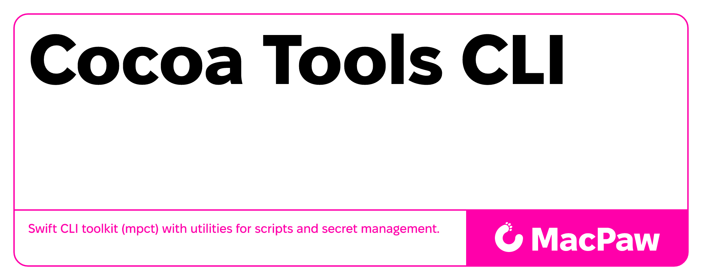

# MacPaw Cocoa Tools CLI (mpct)



A comprehensive Swift CLI toolkit for engineers, providing essential utilities for scripts and secret management.

## Overview

mpct is a modular Swift CLI project targeting macOS 15+ that helps engineers with common development tasks through a collection of specialized modules and commands.

## 🚀 Quick Start

### Installation

### mise

1. Add `mpct` to the `[tools]` section in your `mise.toml`
    ```toml
    [tools]
    "ubi:MacPaw/cocoa-tools-cli" = { version = "latest", exe = "mpct" }
    ```

2. Run `mise install`.

## 🛠 Commands

### Command Structure
```
mpct
├── envsubst              # Environment variable substitution
├── secrets               # Secret management commands
│   ├── export            # Export secrets from providers
│   └── obfuscate         # Generate obfuscated Swift code
└── tests                 # Test result tools
    ├── coverage
    │   └── parse         # Export xcresult coverage
    ├── results
    │   └── parse         # Fetch xcresult test results
    └── report
        └── otel          # Push test metrics to an OpenTelemetry collector
```

### [envsubst](docs/Commands/EnvSubstCommand.md)
Environment variable substitution command.

```bash
mpct envsubst --input template.txt --output config.txt
```

**Key Features:**
- Shell-compatible variable expansion
- Support for default values and error handling
- Stdin/stdout processing
- Strict validation options

### [secrets export](docs/Commands/ExportSecretsCommand.md)
Import secrets from various providers.

```bash
mpct secrets export --config secrets.yaml --source op --destination mise
```

**Key Features:**
- 1Password CLI integration
- HashiCorp Vault integration
- Multiple export formats (dotenv, mise, stdout)
- YAML-based configuration
- Environment variable substitution in configs

### tests report otel
Push metrics about a completed test run to an OpenTelemetry collector over OTLP/HTTP.

```bash
mpct tests report otel --xcresult Build/tests.xcresult --endpoint https://collector.example
mpct tests report otel --xunit .build/tests.xml --dry-run
```

Accepts exactly one of `--xcresult` (macOS only) or `--xunit`. The endpoint and headers fall back
to `OTEL_EXPORTER_OTLP_ENDPOINT` and `OTEL_EXPORTER_OTLP_HEADERS`; there is no built-in default, so
a missing endpoint is a validation error rather than silent data loss.

**Key Features:**
- Emits `cicd.test.case.count` (by result status), `cicd.test.case.duration`, `cicd.test.suite.duration`
  (summed case durations per suite) and `cicd.test.run.duration`
- Per-suite breakdown via `test.suite.name`, disabled with `--no-per-suite` (which also drops `cicd.test.suite.duration`)
- `test.suite.run.status` (`success` / `failure` / `skipped`) on the suite and run duration metrics
- Individual test cases are sent as OTLP **logs**, one record per case (name, suite, status, duration in
  `test.case.*` attributes; the failure message in the body of failed cases), never as metric labels. Records go to
  `--loki-otlp-endpoint` / `LOKI_OTLP_ENDPOINT` (a base URL such as `http://loki:3100/otlp`; `v1/logs` is appended) with
  `--loki-otlp-header` / `LOKI_OTLP_HEADERS`, or else to the OTLP endpoint with the metrics headers. At most 500 records per request. Metrics are sent first; a failing logs export still fails the
  command, so append `|| true` where that should not turn a build red
- Resource attributes (`service.*`, `vcs.*`, `cicd.*`) derived from the detected CI. `service.name` comes from
  `OTEL_SERVICE_NAME` (default `macpaw-test`), `service.instance.id` is `<service>-<run number>`. On GitHub Actions,
  set `JOB_NAME` (for example `${{ github.job }}-${{ matrix.os }}`) in matrix jobs, since `GITHUB_JOB` is shared by every leg
- `--dry-run` prints the payload without sending it; `--no-fail-on-error` keeps a green build green

### [secrets obfuscate](docs/Commands/ObfuscateSecretsCommand.md)
Generate obfuscated Swift code for secrets.

```bash
mpct secrets obfuscate --swift-confidential-config config.yaml --output Sources/Secrets.swift
```

**Key Features:**
- Swift-confidential integration
- Environment variable substitution
- Secret importing integration
- Build-time code generation

## 📦 Modules

### Core Libraries

#### [EnvSubst](docs/Products/EnvSubst.md)
Shell-compatible environment variable substitution in strings and data.

- **Features**: Shell-style variable expansion, default values, error handling
- **Use Cases**: Template processing, configuration file generation
- **Example**: `${VAR:-default}`, `${VAR+alternate}`, `${VAR?error}`

#### [ImportSecrets](docs/Products/ImportSecrets.md)
Comprehensive secret management with support for multiple providers and export destinations.

- **Features**: 1Password integration, YAML configuration, batch operations
- **Use Cases**: Secret importing, environment file generation, CI/CD integration
- **Example**: Import from 1Password to `.env` files or mise configurations

#### [ObfuscateSecrets](docs/Products/ObfuscateSecrets.md)
Swift code generation with obfuscated secret literals using swift-confidential.

- **Features**: Swift-confidential integration, environment variable substitution
- **Use Cases**: Secure secret storage in mobile apps, build-time secret processing
- **Example**: Generate obfuscated Swift accessors for runtime secret access

#### [SemanticVersion](docs/Products/SemanticVersion.md)
Comprehensive semantic versioning implementation with compile-time macro support and build tool integration.

- **Features**: Semantic Versioning 2.0.0 compliance, compile-time `#semanticVersion` macro, build plugin for automatic version generation
- **Use Cases**: Version management, build automation, CI/CD integration
- **Example**: `#semanticVersion("1.2.3-beta.1")`, automatic `.version` file processing


### Supporting Libraries

#### XUnitParser
Cross-platform xUnit XML parser (macOS and Linux).

- **Features**: Parses `<testsuites>` → `<testsuite>` → `<testcase>` → `<failure>` hierarchy; decomposes `classname` into `moduleName`/`suiteName`
- **Use Cases**: Parsing xUnit output from `swift test --xunit-output`, CI test result processing
- **Entry point**: `TestSuites.load(from: URL) throws -> TestSuites`

#### LLVMCoverageParser
Cross-platform LLVM coverage JSON parser (macOS and Linux).

- **Features**: Parses `llvm.coverage.json.export` produced by `swift test --enable-code-coverage`; exposes per-file and aggregate coverage stats (lines, functions, branches)
- **Fixture stripping**: The test fixture strips segments (line-by-line execution data), the top-level functions array (23k+ mangled Swift symbols), and summary fields not modelled by the parser: `instantiations`, `regions`, `mcdc`
- **Use Cases**: Parsing LLVM JSON coverage reports, CI coverage result processing
- **Entry point**: `LLVMCoverage.load(from: URL) throws -> LLVMCoverage`

#### TestsOTELReporter
OpenTelemetry metrics reporter for completed test runs.

- **Features**: Normalizes `.xcresult` and xUnit reports into one model; builds the OTLP metrics payload as JSON and pushes it over HTTP; no OpenTelemetry SDK dependency
- **Use Cases**: Feeding CI test outcomes into Grafana/Mimir alongside the Xcode CAS metrics
- **Entry point**: `TestsOTELReporter(configuration:).report(_ testRun: TestRun) async throws`

#### Shell
Shell command execution utilities with mise integration.

- **Features**: Process execution, mise tool management
- **Use Cases**: Build scripts, tool integration

## 🏗 Architecture

### Modular Design
- **Loose Coupling**: Modules can be used independently (w/o CLI execution)
- **Protocol-Based**: Extensible through well-defined interfaces
- **Type Safety**: Leverages Swift's type system for safety

#### Module Dependencies Sample
```
mpct (executable)
├── EnvSubstCommand → EnvSubst
├── ExportSecretsCommand → ExportSecrets -> ImportSecrets, EnvSubst, Shell
└── ObfuscateSecretsCommand → ObfuscateSecrets → EnvSubst, ExportSecrets
```

## 🔧 Development

See the [docs/DEVELOPMENT.md](./docs/DEVELOPMENT.md) file.

## 📚 Documentation

### Commands
- [EnvSubstCommand](docs/Commands/EnvSubstCommand.md) - Environment variable substitution
- [ExportSecretsCommand](docs/Commands/ExportSecretsCommand.md) - Secret importing
- [ObfuscateSecretsCommand](docs/Commands/ObfuscateSecretsCommand.md) - Secret obfuscation

### Modules
- [EnvSubst](docs/Products/EnvSubst.md) - Variable substitution engine
- [ImportSecrets](docs/Products/ImportSecrets.md) - Secret management
- [ObfuscateSecrets](docs/Products/ObfuscateSecrets.md) - Secret obfuscation
- [SemanticVersion](docs/Products/SemanticVersion.md) - Semantic versioning

## 🔗 Related Projects

- [swift-confidential](https://github.com/securevale/swift-confidential) - Secret obfuscation library
- [swift-argument-parser](https://github.com/apple/swift-argument-parser) - Command-line argument parsing
- [Yams](https://github.com/jpsim/Yams) - YAML parsing for Swift

---

**Built with ❤️ by the MacPaw Foundation/Terminus Team**
